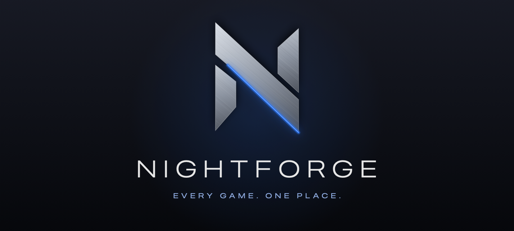
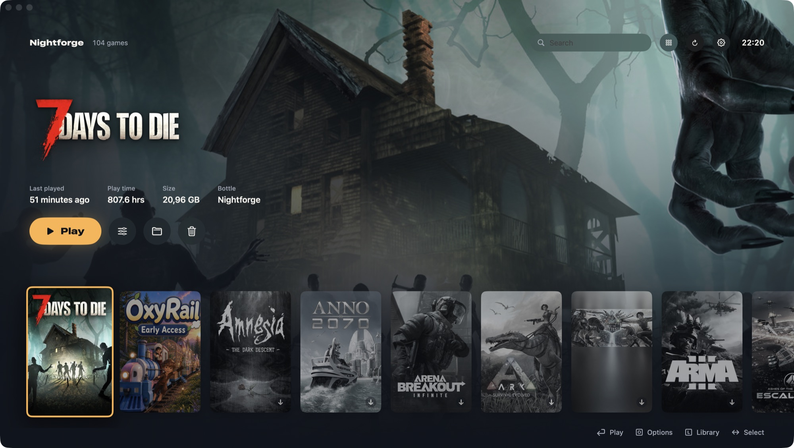
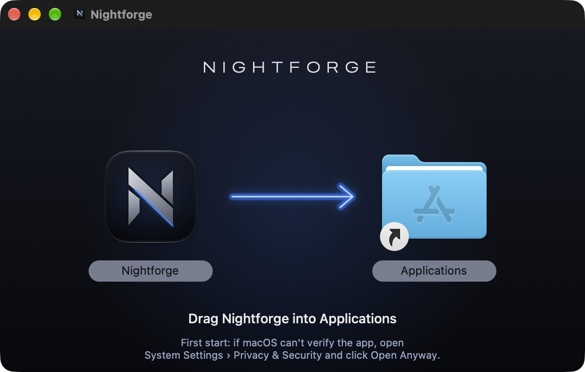
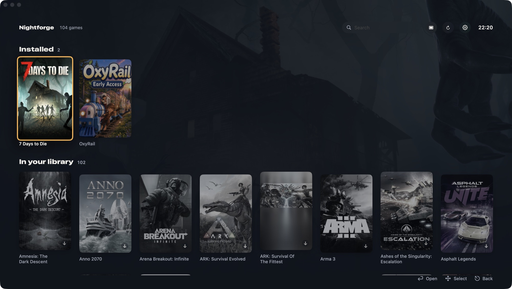
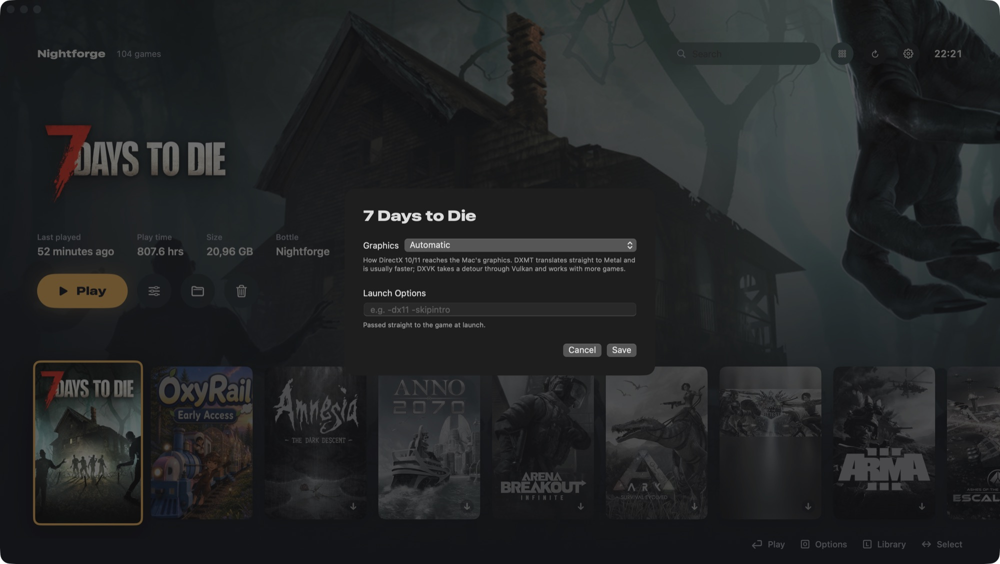

<p align="center">
  
</p>

<p align="center">
  <b>Your Windows Steam games on an Apple silicon Mac. Free, one click, no fiddling.</b>
</p>

<p align="center">
  <a href="https://github.com/LordHayne/Nightforge/releases/latest"></a>
  
  
  
</p>

<p align="center">
  
</p>

Nightforge sets up everything a Windows game needs on your Mac and then gets out of the way. Press **Connect Steam** once, sign in, and your whole Steam library shows up as covers. Pick a game, download it, play. Steam itself stays invisible in the background.

## Why Nightforge

- **One button setup.** The game engine, a Windows environment, Steam and Rosetta (if missing) are set up for you in a few minutes. You only sign in to Steam, in Steam's own window; Nightforge never sees your login.
- **Sharp & smooth, automatically.** Every game gets Apple's MetalFX upscaling to full Retina sharpness and an even frame rate that fits your display (60 FPS on a 120 Hz screen). Nothing to set up; each game can still be tuned in its options.
- **Fast graphics.** DirectX 10/11 goes straight to Metal through DXMT. On an M5, OxyRail runs at about 75 FPS instead of 45–50, and 7 Days to Die at about 63 instead of 30, compared with the Vulkan route.
- **macOS Game Mode.** Games get priority on the CPU and graphics, and controllers and headphones get half the Bluetooth latency.
- **Fixes that arrive by themselves.** A game database is rebuilt every night from the community fixes behind Proton, plus our own profiles tested on Macs. Nightforge applies the right one silently when a game starts.
- **Anti-cheat aware.** Easy Anti-Cheat and BattlEye can't run on a Mac; when Steam offers a way to start a game without them, Nightforge takes it.
- **Your whole library, and the store.** Every game you own, with downloads, uninstall and running games you can switch back to. The search also finds games in the Steam store, with price, Metascore and a link to buy them in your browser; once bought, they appear in your library.
- **Mac versions, automatically.** When Steam has a Mac version of a game that runs on current Macs (64-bit), Nightforge plays that instead of the Windows one – no translation in between. The first time, it sets up Valve's Steam for Mac for you (you sign in in Steam's own window) and downloads the Mac version through it. A game you already play as its Windows version stays playable that way: one click loads its Mac version in the background, and Nightforge switches over once it's there. A small MAC tag shows which games run that way; each game's options can switch back to Windows.
- **Made for the couch too.** Keyboard and controller work everywhere. English and German.
- **Free and quiet.** No account, no telemetry, no background service. Steam is closed when you quit Nightforge and no game or download is running.

## Install

You need a Mac with Apple silicon (M1 or newer) and macOS 14 or later. Open **Terminal** and paste:

```bash
curl -fsSL https://raw.githubusercontent.com/LordHayne/Nightforge/main/scripts/install.sh | bash
```

That installs the newest version into Applications and opens it. From version 0.2 on, Nightforge also updates itself: when a new release is out, an "Update" button appears at the top – one click, and it restarts with the new version.

Prefer clicking? Download the DMG from the [latest release](https://github.com/LordHayne/Nightforge/releases/latest), open it and drag Nightforge onto the Applications folder. Nightforge is free and not registered with Apple, so on first launch macOS says it can't verify it: open **System Settings → Privacy & Security**, scroll down and click **Open Anyway**. The Terminal line skips this step.

## A look inside

<p align="center">
  
</p>

<p align="center">
  
</p>

<p align="center">
  
</p>

## Controls

| Action | Keyboard | Controller |
|---|---|---|
| Choose a game | ← → (Home / End to jump) | D-pad, left stick, LB/RB jump 5 |
| Play | Enter | A |
| Whole library | L | |
| Search | ⌘F | |
| Game options | O | Y or Menu |
| Uninstall | ⌘⌫ | |
| Close / back | Esc | B |
| Rescan library | ⌘R | |
| Settings | ⌘, | |

Clicking a cover selects it; a second click launches the game.

## Settings

Nightforge is meant to be switched on and enjoyed; the defaults give the best result your Mac can deliver.

- **Sharp & smooth:** on by default (see above).
- **Game Mode:** on by default. Turn it off if a game's sound crackles.
- **Performance HUD:** frames per second and frame times in every game.
- **Language:** English or German, or follow macOS.
- **Per game (O):** Mac or Windows version, graphics layer, frame limit, MetalFX and launch options, all on "Automatic" unless you change them.
- **Advanced:** CrossOver and Whisky bottles or your own Wine, folded away until you need them.

## Good to know

- **Online play with anti-cheat** (Easy Anti-Cheat, BattlEye) doesn't work on a Mac. Single player and servers without anti-cheat do.
- **DirectX 9 to 11** is well covered. DirectX 12 games are hit or miss.
- **VR-only games** are marked as such; they can't run on a Mac.
- Saves in the **Steam Cloud** sync as usual.

## How it works

- **Engine:** a free Wine build ([Gcenx](https://github.com/Gcenx/macOS_Wine_builds)) runs Steam and the games in one Windows environment in `~/Library/Application Support/Nightforge`. DirectX 10/11 goes through [DXMT](https://github.com/3Shain/dxmt) (patched for Wine 11, built by `.github/workflows/graphics.yml`), DirectX 9 through [DXVK-macOS](https://github.com/Gcenx/DXVK-macOS) and [MoltenVK](https://github.com/KhronosGroup/MoltenVK). Games that use Vulkan themselves go to MoltenVK through a small layer (`wrapper/nightforge-vulkan-layer.c`) that leaves out what Metal can't do instead of letting the game stop at start.
- **Components:** `components/sources.json` lists what's used; a nightly workflow pins the newest releases with checksums in `components/manifest.json`, which the app downloads and verifies.
- **Steam in the background:** Steam's browser runs through a small wrapper (`wrapper/`) so it draws under Wine, and a tiny library keeps its windows out of the Dock. Games are started with Steam's own `-applaunch`, so licences, cloud saves and updates work as usual.
- **Game Mode:** macOS only grants it to app bundles marked as games, so Wine's loader runs from a small "Nightforge Game" bundle.
- **Mac versions:** the Windows Steam can't download macOS builds, so games that run their Mac version go through Valve's own Steam for Mac. Nightforge installs it from Valve's `steam.dmg` (checking Valve's signature) the first time it's needed, starts it hidden, asks it for downloads the same way as the Windows Steam (an app manifest it picks up at start, so there's no install dialog), shows their progress from what Steam has received over the network (Steam for Mac reserves a game's whole size on disk up front) and starts games with `steam://run`. Steam's catalog says which Mac builds are 64-bit (`osextended` "macos64", or a depot's `osarch`); 32-bit ones no longer run on macOS and stay on Windows, as does a Mac version that ends in its first seconds. Steam for Mac shows its icon in the Dock while it runs and is closed with Nightforge, like the Windows one, when Nightforge started it.
- **Game profiles:** `profiles/profiles.json` is built every night (`.github/workflows/profiles.yml`) from [umu-protonfixes](https://github.com/Open-Wine-Components/umu-protonfixes) plus our Mac-tested profiles in `profiles/mac.json`, which win. `scripts/build-profiles.py` reads the upstream fixes as syntax trees without running them and leaves out what only matters on Linux or would change every game in the shared environment. Profiles set the graphics layer, launch arguments, DLL overrides, Windows version, registry entries and runtimes installed with [winetricks](https://github.com/Winetricks/winetricks).
- **CrossOver and Whisky:** existing bottles are picked up too. Enter the bottles folder and, for anything but CrossOver, the path to `wine` in Settings.

## Contribute a profile

Got a game running better with a specific setting? Add it to `profiles/mac.json` with a short note on what you measured, and open a pull request:

```json
"251570": {
  "name": "7 Days to Die",
  "graphics": "dxmt",
  "note": "M5: ~63 FPS with DXMT, ~30 with DXVK."
}
```

Fields: `graphics` (`dxmt` or `dxvk`), `arguments`, `dllOverrides`, `registry`, `windowsVersion`, `winetricks`, `metalFX` (`false` keeps MetalFX off for a game it doesn't suit), `frameLimit` (the game's automatic FPS limit), `vulkanSamplers` (for games that draw with Vulkan themselves: the samplers per shader stage reported to them, when MoltenVK's 16 make a game refuse to start) and `preferWindows` (`true` keeps a game on its Windows version although Steam has a 64-bit Mac version, e.g. an old OpenGL port that runs worse).

## Build from source

Needs Xcode or the Command Line Tools (`xcode-select --install`). Without Xcode, `build.sh` builds against the macOS 26.5 SDK the Command Line Tools include.

```bash
git clone https://github.com/LordHayne/Nightforge.git
cd Nightforge
./build.sh --install
```

The app ends up in `~/Applications/Nightforge.app` and starts right away. To publish a release, push a tag such as `v0.1.0`: `.github/workflows/release.yml` builds the app and attaches the zip (used by the installer) and the DMG. The logo and app icon are drawn by `scripts/render-brand.swift`.

## Licence

Nightforge is free software under the [GNU General Public License v3.0](LICENSE): you may use, share and change it, and anything built from it that you pass on stays open under the same licence. The game fixes in `profiles/profiles.json` are derived from umu-protonfixes and keep their [BSD-2-Clause notice](profiles/LICENSE-umu-protonfixes). Both licence files ship inside the app.

## Credits

Nightforge stands on the work of [Wine](https://www.winehq.org), [Gcenx's Wine builds and DXVK-macOS](https://github.com/Gcenx), [DXMT](https://github.com/3Shain/dxmt), [MoltenVK](https://github.com/KhronosGroup/MoltenVK), [winetricks](https://github.com/Winetricks/winetricks), [cabextract](https://www.cabextract.org.uk) and [umu-protonfixes](https://github.com/Open-Wine-Components/umu-protonfixes). Their licences apply to the components Nightforge downloads.

Nightforge is not affiliated with Valve or Apple. Steam is a trademark of Valve Corporation; Mac and macOS are trademarks of Apple Inc.
